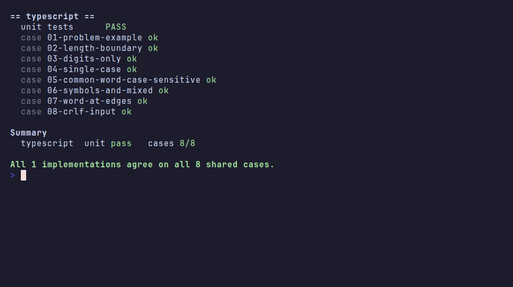
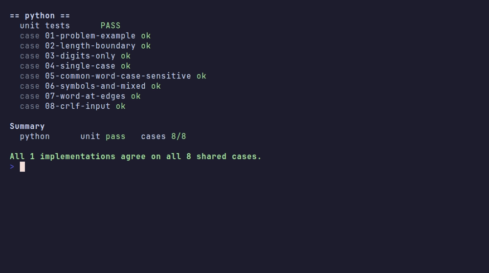
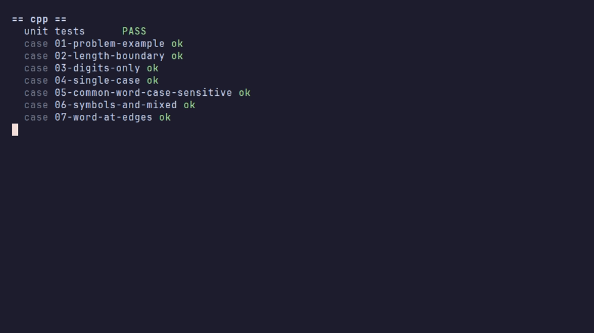
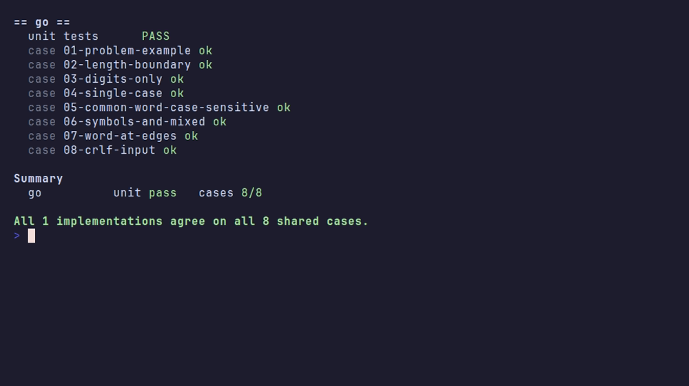
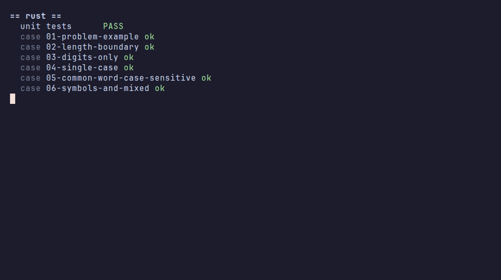
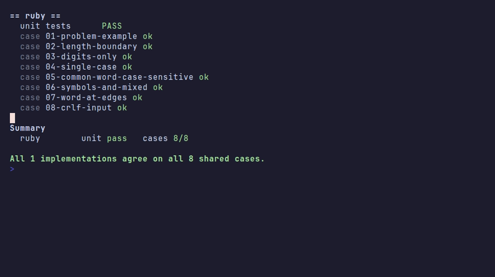
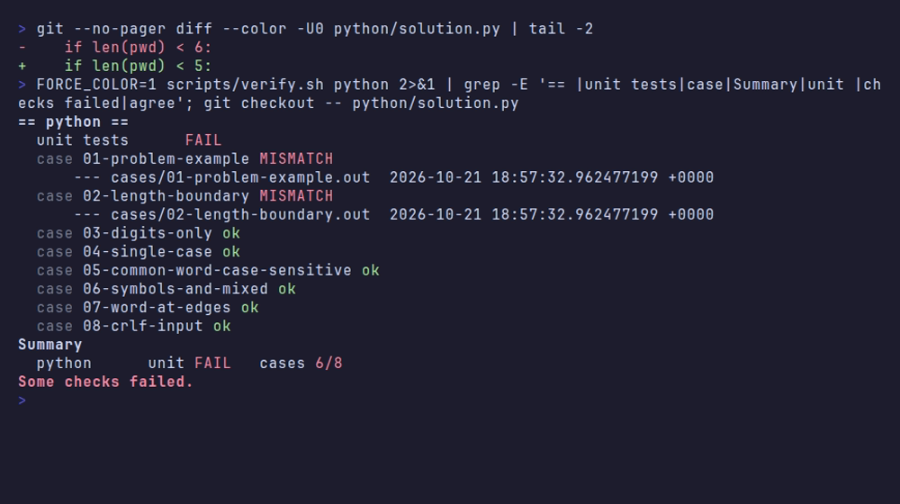

# Proof

Everything in this folder is regenerated by CI on every push to `main`. Nothing here is hand-edited.

| | |
|---|---|
| Commit | [`87735ce`](https://github.com/CloudCorpRecords/password-validation/commit/87735ce0a85910274eb2eadacf26504c38bf3b0f) |
| CI run | [https://github.com/CloudCorpRecords/password-validation/actions/runs/39657299626](https://github.com/CloudCorpRecords/password-validation/actions/runs/39657299626) |
| Generated | 2026-10-21 19:00 UTC |
| Result | All 7 implementations agree on all 8 shared cases. |

## Video

Full run of `scripts/verify.sh`: every language's unit tests, then all shared cases. ([MP4](verify-demo.mp4))


## Screenshots, one per language

### typescript



### python



### cpp



### go



### java


### rust



### ruby



## The tests catch real bugs

CI plants a bug in the Python solution (`len(pwd) < 6` becomes `< 5`), runs the suite, then reverts it.
The unit tests fail and the cases that hit the length boundary mismatch, so a passing run means the tests actually check something.



## Full log

Plain-text output with the exact toolchain versions: [`verify.log`](verify.log)

```
commit:    87735ce0a85910274eb2eadacf26504c38bf3b0f
date:      2026-10-21T18:57:41Z
ci run:    https://github.com/CloudCorpRecords/password-validation/actions/runs/39657299626

```
